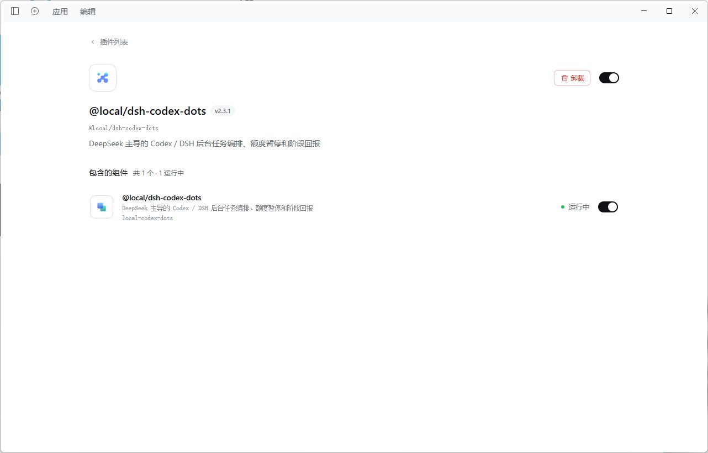
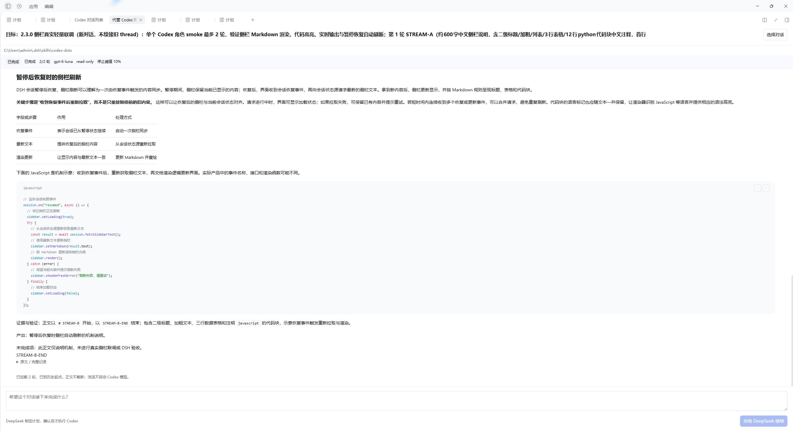

# DSH Codex Dots 2.6.10

让 DSH 中的 DeepSeek 规划任务，后台调度 Codex 或 DSH 子对话，读取输出后继续派发，并在 DSH 对话中汇报阶段结果。提供项目对话列表、接管已有 Codex 对话、Markdown/代码高亮、完整历史、实时输出、额度暂停与人工确认恢复。

当前版本 **2.6.10**，需要 **DSH 0.2.2-rc.3**。

[已发布版本下载](https://github.com/aadmin61-design/dsh-codex-dots/releases/latest) · [更新记录](CHANGELOG.md) · [工具协议](references/protocol.md)

这是社区插件，与 DeepSeek 或 OpenAI 没有官方隶属关系。无需安装新的 Python/前端环境，使用目标电脑已有的 DSH 和 Codex 登录状态。

## 项目对话树（2.6.10）

主页面先显示持久索引，空闲时后台预载其它项目；分支从开头并行比较，遇到分叉停止，未变化结果跨重启复用。后台子代理默认隐藏，可按需显示。

DSH 主页面以浅蓝紫色（Codex）和浅薄荷色（DSH）的毛玻璃悬浮球展示项目。点击项目球在中央展开分层对话树，其余项目缩至两侧；悬停项目根球显示新建、复制项目和删除；悬停对话球显示分支、历史、Dots 和删除。项目文件夹是深度 0，新对话为 1；从对话分支时深度加 1，树枝可显示 DeepSeek 生成的简短分支原因，通过历史按钮预览全文，双击对话球进入 DSH 原生聊天。

“复制项目到 DSH”会复制整个项目的历史并登记到 DSH 原生项目栏；复制完成后双击对话球可直接进入 DSH。重复同步复用已有副本，不覆盖 DSH 中续聊的内容。DSH 对话可原生 fork。两端通过项目下的 「.dsh-codex-dots/tree.json」 共同维护关系，Codex 可使用随包提供的 CLI。原对话保留；最高优先读取子对话的 forked_from_id/forkedFromId；parent_thread_id 只记为子代理委派来源；缺失时比较共同历史，匹配相同时按创建时间选择最近的较早对话，并标注推断关系。

[使用、CLI 与手动验收步骤](docs/orbital-ui.md)。分支摘要可选，会消耗少量 DeepSeek 额度；自动摘要默认关闭。未自动操作 DSH 界面，以下截图仍是旧版代管功能。

## 界面截图

以下为本机 DSH 的真实截图；已收起其他项目列表，仅展示插件页和专门的轻量演示对话。演示正文由 Codex 生成，用于检查 Markdown/表格/代码高亮，不代表截图中的示例代码就是插件实现。

**安装与运行状态（v2.3.2）**

**代管 Codex 对话：Markdown、表格、JavaScript 代码高亮及完整历史**

内容截图回看的是 2.3.0 两轮联调历史；当前插件为 2.6.10。截图中“停止阈值 10%”是该次测试配置，不是新用户的默认预算。实时增量与暂停恢复测试说明见 [验证说明](docs/validation.md)。

新版非界面测试与手动验收步骤见 [2.6.10 验证说明](docs/orbital-ui.md)。上面的界面截图来自 2.3.2；2.6.10 未自动操作 DSH 界面。

## 工作流程

用户明确目标 → DeepSeek 生成计划 → 用户确认计费及计划 → 后台执行 → 完成/受阻事件唤醒 DeepSeek → 核对证据后继续或验收。

等待后台执行时主对话空闲；事件到达后的分析仍会短暂显示思考。达到额度或权限边界时暂停，不会自动提高预算。

## 升级到新版 DSH

2.6.10 适配 DSH 0.2.2-rc.3 的平铺 startActivation 参数、子对话权限守卫与冷恢复，项目对话树和历史迁移需要该宿主版本，本版不再声明旧宿主可运行全部功能。旧版插件在新 DSH 中可能显示“与 DSH 不兼容”，这是依赖版本检查导致的停用。先结束正在运行的任务，用本发行包替换原插件目录里的文件，再重启 DSH；不要删除 `~/.dsh/codex-dots/v2` 任务状态目录。若显示“已停用”，在插件详情重新启用；若仍显示旧版本，通过插件管理器重新安装原目录。

## 其他电脑安装

1. 在目标电脑准备并登录 DSH 和 Codex。本次宿主检查环境：Windows x64、DSH **0.2.2-rc.3**；此前真实 Codex 联调使用 CLI **0.163.0**，本次未新增真实模型轮次。其他系统尚未实测。宿主内部 API 有版本依赖，不能保证任意 DSH 版本兼容。
2. 解压 `dsh-codex-dots-2.6.10.zip`，把其中 `codex-dots` 文件夹放到固定位置，例如 `C:\dsh-plugins\codex-dots`。该文件夹内应直接包含 `package.json`、`index.mjs` 和 `cordis.patch.yml`。
3. 打开 DSH →「插件」→「添加插件」，输入上述文件夹的**绝对路径**，安装并启用。目录安装使用本地链接，安装后请保留目录，不要从临时解压预览里安装。
4. 若界面提示重启，先停止正在运行的任务再重启 DSH。在插件详情中核对 **v2.6.10**、组件「运行中」，左侧应出现统一入口「项目对话树」，Dots 在对话球的操作抽屉中。
5. 在 DSH 主对话选择 DeepSeek，先发送：**“调用 dots_probe 检查本机 Codex 的可用模型和额度，只做查询，不启动任务。”** 查询会启动本机 app-server，但不会启动 Codex 模型轮次；DeepSeek 回复仍消耗其自身额度。

另提供 npm 格式 `.tgz` 发行文件，供接受本地 tarball 的包管理流程使用。普通用户优先按上述 ZIP 解压目录流程安装，不需要执行 npm install，不需要上传 npm 仓库。

插件依赖 DSH 自带的 Cordis、工具、子对话和 UI 服务，通过声明的 peerDependencies 复用；无需另外安装 React、Python 或前端构建环境。包中包含源码，无二进制构建步骤。可选终端状态栏诊断才需要 requirements.txt 中的 Python 库，不是主插件运行条件。

## Codex 路径与本机数据

插件默认从当前用户的常见 Windows npm/桌面安装目录发现 Codex，未发现时尝试 PATH 中的 `codex`。如果 dots_probe 报找不到程序，在 DSH 插件配置中把 `codexBin` 设置为**目标电脑实际 codex.exe 的绝对路径**，或在启动 DSH 前设置 `CODEX_BIN`，然后重启 DSH。不要把 Windows 的 codex.cmd 启动脚本当作 exe 路径。

发行包不携带原电脑的账号、登录凭据、API 密钥、聊天历史、运行日志或任务状态。目标电脑必须自己登录；侧栏只能查询其本机 Codex 可访问的对话，原电脑的对话不会随插件迁移。

默认状态目录按当前用户动态生成：`~/.dsh/codex-dots/v2`。任务工作目录在创建计划时指定，必须是目标电脑存在的目录；不要照抄另一台电脑的路径或 threadId。可选技能菜单入口取决于 DSH 的技能扫描配置，插件安装本身已注册 dots_* 工具和系统提示。

## 首次轻量验证

先完成只读 dots_probe 检查，再按需发起下面的测试（将目录和阈值换成自己确认的值）：

> 使用 codex-dots，在我的测试目录进行只读联调。最多两轮：第一轮输出带标题、表格和代码块的 Markdown，然后暂停；我确认恢复后第二轮回复完成。不要执行命令或修改文件。先说明额度消耗并给出计划，由我确认后开始。

核对两次原生确认（启用/费用、完整计划），再观察侧栏实时正文、暂停状态，以及确认恢复后的自动续发和刷新。模型任务会消耗该电脑登录账号的 Codex/DeepSeek 额度，不会自动取消阈值。不要接管正在被其他客户端派发的同一对话。

有 Node.js 22 或更新版本时，可在插件目录执行 `node --test tests/*.test.mjs` 做离线验证；测试使用协议替身，不调用模型。真实 DSH 宿主检查方法见 [安装与验证](references/install.md)。本发行版已通过 75 项离线测试及本机 DSH 宿主冒烟测试；不代表其他电脑已经验证。

## 功能与限制

- 通过 dots_threads/dots_thread_read 查询对话，或在「项目对话树」选择悬浮球；在球旁的 Dots 窗口填写目标，交给 DeepSeek 制定接管计划。
- 代管内容侧栏支持 Markdown、代码高亮、完整历史以及实时增量，正文不按 6000 字截断。
- 暂停、恢复、预算和权限变更保持用户确认边界；达到提醒/轮次/超时上限会停止推进并报告异常。
- 2.3.1 为计划提供结构化参数；明确尚未执行的 dots_start JSON 解析错误，每个 DeepSeek 轮次最多重生成一次。不会自动执行损坏 JSON 或重放结果不明的工具。
- DSH 退出、电脑休眠或断网时无法保证继续推进；重启后未完成任务保持暂停，需要核对后确认恢复。
- 额度百分比不是现金余额；检查与收尾存在延迟，不是绝对费用硬上限。

详细使用：[SKILL.md](SKILL.md)；参数和状态边界：[工具协议](references/protocol.md)；故障处理：[安装说明](references/install.md)。

2.6.10：DSH 原生对话直接进入；悬停根球可复制项目、删除项目，对话球可删除对应历史。操作窗口居中显示。永久删除需两次确认，DSH 历史在完全退出应用后清理；详情和手动验收见 [对话星图说明](docs/orbital-ui.md)。
